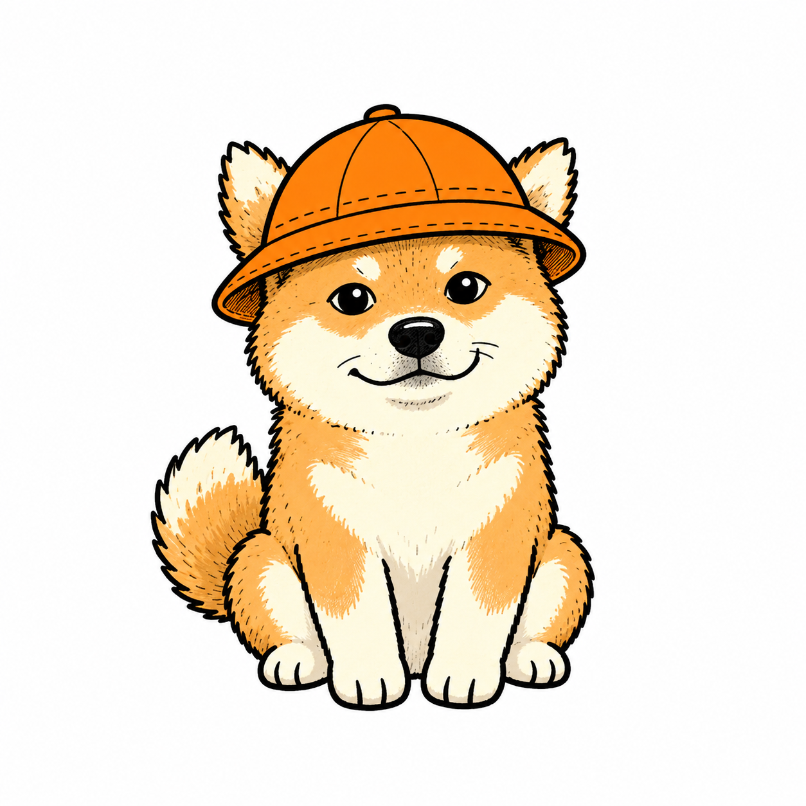

# 小柴 Xiaochai

戴橙色渔夫帽、泡在水里也很淡定的柴犬。我们的自媒体 IP，以及一个给中文文章出**封面 + 正文配图**的 AI Skill（Claude Code / Codex 通用）。

<p> </p>

## 仓库内容

| 目录 | 内容 |
|---|---|
| `xiaochai/` | Skill 本体 |
| `xiaochai/xiaochai-ip.md` | 角色设定：长相、性格、禁忌 |
| `xiaochai/assets/character/sheet/` | 小柴标准照，长相唯一标准 |
| `xiaochai/cover/` + `xiaochai/styles/` | 封面工作流与 30 种封面风格（含默认的"小柴原生手绘封面"） |
| `xiaochai/illustration/` | 正文配图工作流 |
| `gallery/` | 已产出的小柴图片，每张附画法说明 |

## 安装

```bash
git clone https://github.com/Chenzr888/czr-xiaochai-ip.git
cp -R czr-xiaochai-ip/xiaochai ~/.claude/skills/
cp -R czr-xiaochai-ip/xiaochai ~/.codex/skills/
```

## 用法

- 全套：`Use $xiaochai 给这篇文章做一张小红书封面和 4 张正文配图：<正文>`
- 只做封面：`Use $xiaochai 做一张公众号封面：<正文>`（会先问平台、推荐三种风格）
- 只规划配图：`用小柴配图，先别生图，出 5 张 shot list：<正文>`

## 版权与署名

- **小柴角色形象及本仓库中的全部小柴图片**：© 2026 Chenzr888，保留所有权利。未经许可，不得商用，不得作为其他品牌或 IP 使用。
- **Skill 的工作流与文字框架**按 MIT 许可改编自：
  - Ian 的 [Ian Xiaohei Illustrations](https://github.com/helloianneo/ian-xiaohei-illustrations)，见 `LICENSE-IAN-MIT`
  - adrianpunk 的 [Punk Skill](https://github.com/adrianpunk/Punk-Skill) **v1.0.0-mit** 版本，见 `LICENSE-PUNK-MIT`

详见 `NOTICE.md`。
